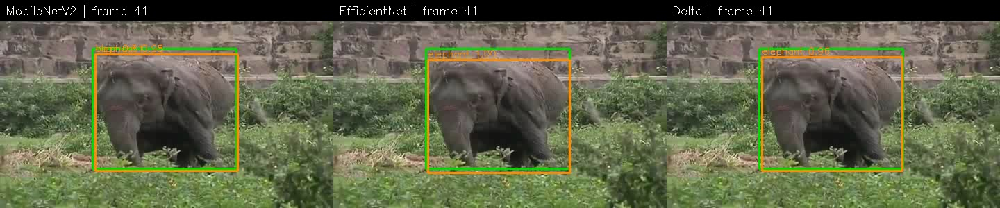

# Memory-Guided Video Object Detection

Efficient video object detection for the **30 ImageNet VID classes**: can a small
model use memory from a larger model to improve accuracy at lower inference cost?
This project explores **shared LSTM memory** and **cached-feature attention**, inspired
by [Looking Fast and Slow: Memory-Guided Mobile Video Object Detection](https://arxiv.org/abs/1903.10172)
(CVPR 2019) and compared with [Delta Distillation for Efficient Video Processing](https://www.ecva.net/papers/eccv_2022/papers_ECCV/papers/136950209.pdf)
(ECCV 2022). These are research variants, not exact reproductions of either paper.

## Setup and data

From the project root, create a **new** environment (Linux/NVIDIA example):

```bash
conda create -n vision python=3.11 pip -y
conda activate vision
python -m pip install torch==2.6.0 torchvision==0.21.0 --index-url https://download.pytorch.org/whl/cu124
python -m pip install -r requirements.txt
```

Use the matching [official PyTorch installation](https://pytorch.org/get-started/previous-versions/#v260)
for other hardware. Launchers activate `vision` and use CUDA; direct entry points
also accept `--device cpu`. Initial backbone weights download through `timm`.

Download `ILSVRC2015_VID.tar.gz.aa`, `ILSVRC2015_VID.tar.gz.ab`, and
`annotations.tar.gz` from the [ImageNet VID Hugging Face mirror](https://huggingface.co/datasets/guanxiongsun/imagenetvid/tree/main).
Join the two VID parts before extracting:

```bash
cat ILSVRC2015_VID.tar.gz.aa ILSVRC2015_VID.tar.gz.ab > ILSVRC2015_VID.tar.gz
tar -xzf ILSVRC2015_VID.tar.gz
```

Extract the annotation archive too, and arrange the dataset beside the project:

```text
workspace/
├── mobile_vod/
└── ILSVRC2015/
    ├── Data/VID/{train,val}/...
    └── Annotations/
        ├── imagenet_vid_train.json
        └── imagenet_vid_val.json
```

The loader needs **video-aware COCO JSON**, not XML: `videos`, `images` (with
`video_id`/`frame_id`), `annotations`, and `categories`. Frame paths are relative to
`Data/VID`. Preserve annotation bytes for checkpoint/manifest hash checks. These
trainers use VID only; ImageNet DET is not required.

Set `DATASET_ROOT = PROJECT_ROOT.parent / "ILSVRC2015"` in
[`utils/path.py`](utils/path.py), and check the derived train/validation paths.
Outputs default to `runs/` and `results/`; datasets and checkpoints are not in Git.

**Attention/Delta dependency:** clone the project's
[Delta fork](https://github.com/MahsaElyaderani/delta-distillation) beside this checkout,
obtain `checkpoints/test/efficientdet_d0.pth` from the
[official release](https://github.com/Qualcomm-AI-research/delta-distillation/releases/tag/v1.0),
and set `DELTA_ROOT` and `DELTA_TEACHER_CHECKPOINT` in `utils/path.py`.
The adapter requires the fork's `baseline/evaluate_tracking.py`, not just the upstream
checkout. Both attention variants require the frozen teacher for keyframe evaluation.

## Reproducible training subsets

Use the checked-in manifests in [`splits/`](splits/). They select **whole videos**,
retain consecutive clips, and target a fraction of **frames**, not video count.
Use the same manifest for both stages and every model; keep validation unchanged.

| Training selection | Videos | Frames | Six-frame clips | Minimum class coverage: distinct clip-containing videos |
| --- | ---: | ---: | ---: | ---: |
| 25% | 1,796 | 280,581 | 46,064 | 36 |
| 50% | 2,615 | 561,181 | 92,540 | 56 |

Selection jointly balances positive frames/clips, rewards distinct videos, and
normalizes gains by video length. Both subsets cover all 30 classes; 25% is nested
in 50%. Balance is approximate; video diversity does not guarantee appearance
diversity. Counts precede augmentation and incomplete-batch dropping.

For new fractions, save selected `video_ids`, the annotation hash, and per-class
counts using the same scoring rule. Exact regeneration currently requires the local
`select_candidates.py` and `training_audit.json` bundle (**not distributed in Git**);
use the supplied manifests for 25%/50%. The tracked
[`scripts/sample_vid_videos.py`](scripts/sample_vid_videos.py) creates per-class video
samples, not frame-balanced fractions.

<details>
<summary>Prepare the organized manifests once (25%, 50%, full training, and validation)</summary>

After configuring paths, run from the project root:

```bash
python - <<'PY'
import hashlib, json, shutil
from utils.path import RUNS_DIR, TRAIN_ANNOTATIONS, PROJECT_ROOT
folder = RUNS_DIR / "experiments/manifests"
folder.mkdir(parents=True, exist_ok=True)
for name in ("train_25pct.json", "train_50pct.json", "val100x20_seed7.json"):
    if not (folder / name).exists():
        shutil.copy2(PROJECT_ROOT / "splits" / name, folder / name)
raw = TRAIN_ANNOTATIONS.read_bytes()
full = folder / "train_100pct.json"
if not full.exists():
    full.write_text(json.dumps({"annotations_sha256": hashlib.sha256(raw).hexdigest(),
                              "video_ids": sorted(v["id"] for v in json.loads(raw)["videos"])}))
PY
```

</details>

## Models and training

| Family | Small backbone | Big backbone / teacher | Memory and detector |
| --- | --- | --- | --- |
| MobileNetV2 LSTM | `mobilenetv2_050.lamb_in1k` | `mobilenetv2_120d.ra_in1k` | Standalone small, standalone big, or joint LSTM + SSD |
| EfficientNet LSTM | `tinynet_d.in1k` | `efficientnet_b0.ra_in1k` | Same three configurations |
| Attention | TinyNet-D through `blocks.4` | Frozen EfficientDet-D0 | `no_memory` or `attention_memory`, both with SSD and no LSTM |

**LSTM:** small/big inputs are 160×160/320×320. Standalone classification pretraining
uses a backbone plus a temporary multi-label head; joint pretraining adds the shared
LSTM and repeats each image for three recurrent steps. Detection transfers these
weights into an LSTM + SSD detector. Standalone memory updates every frame; joint
memory is committed only on big calls. Joint training uses random branch selection,
not the fixed inference schedule.

**Attention:** current 160×160 student features query the frozen 512×512 teacher's
cached P4. Retrieved features are added to the student's 64-channel map before SSD;
`no_memory` uses that map alone. Fresh training samples six distinct student frames
following one keyframe in a 10-frame window, computes teacher P4 once, and averages
the student losses. It uses detection supervision, not a feature-distillation loss.

| Fresh-run settings | LSTM classification | LSTM detection | Attention detection |
| --- | --- | --- | --- |
| Epoch budget | 5 | 100 | 100 |
| Batch size | 8 images | 4 six-frame clips | 4 ten-frame windows |
| Initial LR / decay | 0.01 / linear | 0.001 / cosine | 0.001 / cosine |
| Optimizer | RMSprop | RMSprop | RMSprop |
| Best checkpoint | Highest final-step micro AP | Highest continuous mAP@0.5 | Highest student-frame COCO AP50 |

Validation runs every 5,000 optimizer updates and at budget completion. Defaults use
100 validation videos × up to 20 consecutive frames (seed 7), **not full validation**.
Classification uses BCE across predicted steps. Smaller subsets mean fewer updates
per epoch; the predetermined update budget sets the LR schedule.

Run one command at a time. These examples create separate **full-training-data** runs;
replace `TRAIN_SUBSET=1` with `0.25` or `0.5` and choose a corresponding new `RUN_NAME`
for smaller budgets:

```bash
TRAIN_SUBSET=1 RUN_NAME=full_seed0 EARLY_STOPPING=1 bash launchers/run_lstm_experiments.sh mobilenetv2 train
TRAIN_SUBSET=1 RUN_NAME=full_seed0 EARLY_STOPPING=1 bash launchers/run_lstm_experiments.sh efficientnet train
TRAIN_SUBSET=1 RUN_NAME=full_seed0 EARLY_STOPPING=1 bash launchers/run_attention_experiments.sh train
```

Repeating a command resumes its **latest** checkpoint with saved settings; evaluation
uses **best**. Early stopping means 10 validations without strict improvement; it is
optional and does not reset the LR schedule. A different subset requires a separate run; attention cannot expand its
subset on resume. Joint LSTM continuation is available through the direct
`--expand-subset` option, but is not equivalent to fresh full-data training.

Checkpoints live under `runs/experiments/lstm/<family>/<small|big|joint>/<RUN_NAME>/`
or `runs/experiments/attention/tinynet_d/<variant>/<RUN_NAME>/`. Without overrides,
shared launchers select the organized 25% runs, including existing saved budgets.

```bash
bash launchers/show_train_history.sh runs/experiments
```

For code review: launchers → `train_lstm_models.py` / `train_attention_models.py`
(setup) → `engine/trainer_*.py` (loops) → `models/` (architectures).
`utils/checkpoint.py` handles resume; `utils/metric.py` and `utils/visualizer.py`
handle metrics, predictions, and visual exports.

## Evaluation

Replace `train` with `eval` in the launcher commands above, retaining the same
`TRAIN_SUBSET` and `RUN_NAME`. LSTM evaluation requires all three best checkpoints;
attention requires both. Results go to a fresh folder under `results/`.

**Quick validation:** shared launchers use 100 videos × up to 20 consecutive frames.
LSTM caps can be changed with `MAX_VAL_VIDEOS` and `VAL_FRAMES_PER_VIDEO`; attention
uses the saved validation manifest. Shared LSTM evaluation uses interval **8**;
attention uses **10**. Do not treat these default runs as the paper comparison.

**Full validation, fixed 1 big + 9 small:** evaluate an individual joint LSTM checkpoint
without video/frame caps. For standalone models use `--mode big` (the sole branch,
even for a small model). Set `CHECKPOINT` to the desired best checkpoint first:

```bash
python train_lstm_models.py eval --checkpoint "$CHECKPOINT" \
  --mode fixed --interval 10 --score-threshold 0 --max-detections 100 \
  --warmup-frames 10 --no-losses --no-visuals --device cuda \
  --output-dir "results/full_val_$(date +%Y%m%d_%H%M%S)"
```

For the same interval-10 test on a subset, add `--max-videos 100
--frames-per-video 20 --subset-seed 7`.
Omitting caps evaluates every frame in the validation JSON; remove `--no-visuals`
for videos. Full-data training does not imply full-validation evaluation.

For LSTM/Delta comparisons, [`scripts/compare_vid.py`](scripts/compare_vid.py) evaluates
one shared manifest at interval 10 and reports both COCO AP50 (101 recall points)
and continuous-envelope AP50. Its `export` command currently creates only the
100×20 subset. Full-validation manifest export needs extending before a reproducible
full LSTM/Delta benchmark. Attention evaluation additionally rejects a manifest
that differs from its checkpoint: evaluating existing attention checkpoints on full
validation needs a deliberate evaluation-only change, not editing checkpoint hashes.

Use identical validation frames, class mappings and scoring, synchronous float
inference, and video-boundary memory resets. Include keyframe cost; report
student-only AP separately. Use the same idle GPU or one-thread CPU. Delta batching
and LSTM streaming have different timing scopes and partial operation counters:
**current FPS/GFLOPs are not a controlled speed ranking**.

## Results and qualitative examples

**Target: full VID training and full validation. Pending means not yet measured under
that protocol.** Existing checkpoint-selection metrics and subset evaluations do not
fill these cells. The full-data EfficientNet continuation has completed its budget,
but its recorded validation is still a subset; it must be evaluated on full validation.

| Model / source | Fixed schedule | mAP@0.5 (%) | Compute / frame | FPS |
| --- | --- | ---: | --- | --- |
| Looking Fast and Slow, Table 2: synchronous, non-quantized, no extra COCO | 1 big + 9 small | 58.9 | 0.190 GMAC | 23.5 (Pixel 3) |
| Delta Distillation, published Table 1: EfficientDet-D0 + Delta | 1 teacher + 9 student | 66.1 | 0.71 G multiply-adds | Not reported in table |
| Joint MobileNetV2-LSTM, this project | 1 big + 9 small | Pending | Pending | Pending |
| Joint EfficientNet-LSTM, this project | 1 big + 9 small | Pending | Pending | Pending |

Paper rows are **reference results, not matched reruns**: see
[Looking Fast and Slow, Table 2](https://arxiv.org/pdf/1903.10172) and
[Delta Distillation, §4.1/Table 1](https://www.ecva.net/papers/eccv_2022/papers_ECCV/papers/136950209.pdf).
Delta also trains with ImageNet DET images (1:1 with VID). Its paper calls
multiply-adds “FLOPs”; this project's convolution/linear counter uses two FLOPs per
MAC. Match counting conventions before comparing compute. The released Delta
repository lists a different operating point (66.0 mAP, 0.63 GMac); do not confuse
that with the published table or assume downloaded weights reproduce its 66.1 row.

| Full-train/full-val ablation | Small / no-memory AP50 | Big standalone AP50 | Joint / attention-memory AP50 |
| --- | ---: | ---: | ---: |
| MobileNetV2 + LSTM | Pending | Pending | Pending |
| TinyNet-D / EfficientNet-B0 + LSTM | Pending | Pending | Pending |
| TinyNet-D attention experiment (whole sequence, teacher keyframes in both variants) | Pending | — | Pending |

Use one AP50 definition for that table; preserve each checkpoint's training history
(fresh versus subset continuation). Also retain per-class AP and class coverage.
The attention baseline includes teacher keyframes, so it is not a teacher-free
standalone detector.

**Existing subset example, not the full-data benchmark:** the saved interval-10 CPU
comparison covers 100 videos / 1,999 frames. COCO AP50 is 45.85% for joint MobileNetV2,
51.04% for joint EfficientNet, and 74.11% for Delta. These project checkpoints came
from 25% training runs. The image below is the first frame of that saved comparison
(video 21, frame 41): green = ground truth; orange = detections. It is a keyframe,
so Delta's panel uses its teacher. It illustrates output layout, not aggregate accuracy.



Exports save `detections.jsonl`; attention launchers also save videos. Render
aligned saved runs without repeating inference:

```bash
python -m evaluate.compare_detection_runs --runs RUN_A RUN_B \
  --frames-root "$(python utils/path.py --get VAL_FRAMES)" --output-dir NEW_FOLDER
```

Use identical evaluated frames and compatible export settings.
